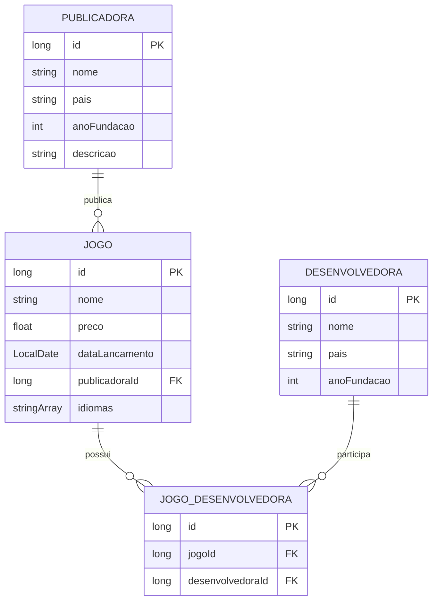

# Modelagem da Fase III

O catálogo mantém Publicadora → Jogo (1:N) e acrescenta Jogo ↔ Desenvolvedora (N:N). A interface utiliza os serviços de negócio sobre os arquivos binários já implementados.

A proposta da Fase I também previa Plataformas e Gêneros. Esses cadastros e seus relacionamentos não existem na versão atual e não fazem parte da lista solicitada para a Parte 3; este diagrama documenta somente o que está implementado. O relacionamento Jogo–Desenvolvedora permite inicialmente zero vínculos, para cadastrar as entidades antes de associá-las.

## Modelo de entidades

Cada jogo tem exatamente uma publicadora válida. Publicadoras, jogos e desenvolvedoras podem começar sem associações N:N. Um jogo pode ter várias desenvolvedoras e uma desenvolvedora pode participar de vários jogos. O par `(jogoId, desenvolvedoraId)` deve ser único. O vínculo também recebe um ID técnico para atender ao contrato `Registro` de `Arquivo<T>`; ele não substitui a unicidade do par.

## Organização física

| Registro | Arquivo de dados | Índice primário |
| --- | --- | --- |
| Jogo | `dados/jogos/jogos.db` | `dados/indices/jogos.dir` e `.bkt` |
| Publicadora | `dados/publicadoras/publicadoras.db` | `dados/indices/publicadoras.dir` e `.bkt` |
| Desenvolvedora | `dados/desenvolvedoras/desenvolvedoras.db` | `dados/indices/desenvolvedoras.dir` e `.bkt` |
| JogoDesenvolvedora | `dados/jogos_desenvolvedoras/jogos_desenvolvedoras.db` | `dados/indices/jogos_desenvolvedoras.dir` e `.bkt` |

`Arquivo<T>` mantém um cabeçalho de 16 bytes (último ID e início da lista de espaços excluídos). Cada registro contém lápide, tamanho de dois bytes e payload serializado. O payload do vínculo tem 24 bytes: três campos `long`. Strings usam `writeUTF`; datas de jogos são serializadas como dias desde a época; idiomas são multivalorados.

| Índice secundário B+ | Pares persistidos | Consulta |
| --- | --- | --- |
| `arvore_pub_jogo.db` | `(publicadoraId, jogoId)` | Jogos da publicadora |
| `arvore_jogo_vinculo.db` | `(jogoId, vinculoId)` | Desenvolvedoras do jogo |
| `arvore_desenvolvedora_vinculo.db` | `(desenvolvedoraId, vinculoId)` | Jogos da desenvolvedora |

As árvores armazenam IDs, não posições físicas das entidades. As consultas N:N recuperam IDs técnicos dos vínculos na árvore, leem as associações pelo Hash, extraem os IDs das entidades e consultam seus serviços para mostrar os dados completos. A duplicidade é verificada pelo par real, sem usar um hash do par como garantia de unicidade.

## Camadas e ciclo de vida

| Camada | Responsabilidade |
| --- | --- |
| `Main` | Iniciar exclusivamente a interface Swing; o driver de console existe somente nos testes de regressão. |
| `interfacegrafica.JanelaPrincipal` | Abas, tabelas, formulários, confirmação de exclusão e mensagens. |
| `interfacegrafica.Catalogo` | Abrir uma sessão de arquivos, conectar serviços, ordenar e fechar recursos. |
| `ServicoJogo`, `ServicoPublicadora`, `ServicoDesenvolvedora` | Operações de CRUD e integridade referencial. |
| `RelacionamentoJogoDesenvolvedora` | Validar as entidades e expor inclusão, remoção e consultas de vínculos. |
| `Arquivo`, `ArquivoJogoDesenvolvedora`, Hash e B+ | Serialização, armazenamento e manutenção dos índices. |

Os componentes são manipulados na EDT do Swing. Cada ação de arquivo executa em `SwingWorker`; os controles ficam desabilitados enquanto há uma operação em andamento, incluindo o fechamento, evitando acesso concorrente aos mesmos `RandomAccessFile`.

Na ordenação, `Catalogo` fecha o arquivo de jogos, executa distribuição/intercalação/finalização, reabre o arquivo e reconecta os serviços ao novo objeto. O Hash é reconstruído com os novos endereços; os índices secundários continuam referenciando os IDs preservados. Todas as tabelas e seletores são recarregados.

## Integridade e limites

- Cadastro e atualização de jogo exigem publicadora existente; troca de publicadora remove o par antigo da B+ e inclui o novo.
- Associação exige jogo e desenvolvedora existentes; repetição do mesmo par retorna uma mensagem sem criar outro vínculo.
- Exclusão de jogo ou desenvolvedora com associações N:N é bloqueada. É necessário remover os vínculos explicitamente antes de excluir.
- Exclusão de publicadora com jogos é bloqueada. Primeiro é necessário excluir os jogos ou transferi-los para outra publicadora.
- Atualizações preservam os IDs; associações continuam válidas quando nomes ou outros atributos são alterados.
- A interface valida campos obrigatórios, preço finito não negativo, ano de fundação e data. Essas validações de formulário complementam os serviços existentes.
- O marcador `.pendente` do N:N permite reconstrução dos índices após uma atualização incompleta. O projeto não implementa transações ACID, recuperação geral de corrupção nem acesso simultâneo por várias instâncias da aplicação.

As entidades e formatos anteriores foram preservados. A principal evolução desta etapa é a interface gráfica e a conexão das regras existentes à sessão gráfica; `ServicoPublicadora` extrai a proteção 1:N para uma operação reutilizável fora do console.
